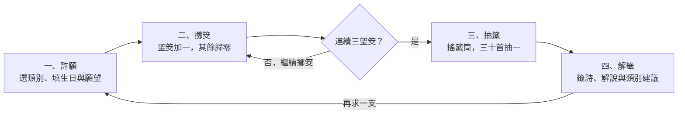

# 線上擲筊求籤 Web App 規格書

線上網址：<https://lswen-lee.github.io/yunduan-fortune/>

最後更新：2026-10-12

## 一、專案概述

「雲端宮線上靈籤」讓使用者在網頁上許願、擲筊，連續擲出三個聖筊後抽出一支原創籤詩，並看到白話解說。

| 項目 | 內容 |
| --- | --- |
| 作品名稱 | 雲端宮線上靈籤（「雲端宮」為虛構廟名） |
| 目標使用者 | 想體驗傳統求籤流程，或做決定前想找個趣味參考的人 |
| 使用裝置 | 手機與電腦的瀏覽器皆可，不需安裝、不需登入 |
| 核心玩法 | 許願 → 擲筊 → 連續三個聖筊 → 抽籤 → 解籤 |
| 交付形式 | 單一 `index.html`，以 GitHub Pages 公開，網址為 https://lswen-lee.github.io/yunduan-fortune/ |
| 定位聲明 | 僅供娛樂，不代表任何真實宮廟，頁尾固定顯示此聲明 |

## 二、使用流程

使用者依序經過許願、擲筊、抽籤、解籤四個階段，其中擲筊會重複到連續三個聖筊為止。



聖筊讓連續數加一，笑筊或陰筊讓它歸零；滿三次才進入抽籤，解籤後按「再求一支」回到許願。

## 三、功能規格

整個網頁只有一頁，依階段切換四個畫面；頂端的步驟指示會標出目前所在階段。

### 3.1 許願畫面

| 欄位 | 形式 | 必填 | 規則 |
| --- | --- | --- | --- |
| 所求類別 | 六個單選按鈕：學業、感情、事業、健康、財運、其他 | 是 | 預設不選，一次只能選一個 |
| 生日 | 日期選擇器 | 是 | 不可晚於今天，也不可早於 1900 年 |
| 想請示的事 | 多行文字框 | 是 | 2～100 字，右下角即時顯示字數 |

- 「開始擲筊」按鈕：三個欄位都合格才會進入擲筊；未合格時按鈕呈半透明，按下會在該欄位下方顯示紅字提示（「請選擇一個類別」「請填寫生日」「生日不可晚於今天」「請至少輸入 2 個字」）。
- 生日只用來組成稟告文，以民國紀年顯示，不影響抽籤結果。
- 不收姓名。願望與生日只留在當下畫面，不儲存、不上傳，重新整理即清空。

### 3.2 擲筊畫面

- 稟告文：由輸入組成，例如「弟子生於民國 94 年 3 月 12 日，今為學業之事請示：期中考能否順利？」類別選「其他」時改寫成「今有一事請示」；內容超過四行時在框內捲動。
- 兩個筊杯與「擲筊」按鈕，鍵盤空白鍵效果相同。
- 按下後播放約 1 秒的拋起、翻轉、落地動畫，動畫期間按鈕停用，避免連點。
- 落地後顯示結果名稱與一句說明，兩個筊杯下方各自標示「平面」或「凸面」（聖筊、笑筊、陰筊，定義見第四節）。
- 連續聖筊進度：三盞燈號，每個聖筊點亮一盞，歸零時全部熄滅。
- 累計擲筊次數，以及本次的擲筊歷程（例如「聖 聖 笑 聖 聖 聖」）。
- 達成三連聖筊後，「擲筊」按鈕換成「前往抽籤」；未達成前沒有任何方式可以進入抽籤。
- 「重新許願」連結：回到許願畫面並清空進度，已填的類別、生日與願望保留。

### 3.3 抽籤畫面

- 畫面中央是籤筒，點擊籤筒或「搖籤筒」按鈕開始抽籤。
- 籤筒左右搖晃約 1.5 秒，之後一支籤升起並顯示籤號（第 1～30 籤）。
- 每次求籤只能抽一支，抽出後按鈕換成「看籤詩」。

### 3.4 解籤畫面

籤詩卡依序顯示：

1. 籤號與等級，例如「第七籤・上吉」
2. 四字籤題
3. 四句七言籤詩，直排、由右至左
4. 白話解說
5. 針對所選類別的一句建議
6. 使用者輸入的願望文字

卡片下方有三個按鈕：

| 按鈕 | 行為 |
| --- | --- |
| 複製籤詩文字 | 把籤號、等級、籤題、籤詩、解說、建議複製到剪貼簿，按鈕文字變成「已複製」2 秒 |
| 下載籤詩圖片 | 產生一張 1080×1350 的 PNG 籤詩卡，檔名為「雲端宮第N籤.png」；圖片不含生日與願望文字 |
| 再求一支 | 回到許願畫面，保留類別與生日，清空願望文字、進度與擲筊歷程 |

### 3.5 音效與靜音

| 時機 | 音效 |
| --- | --- |
| 筊杯落地 | 兩聲短促的木頭敲擊聲 |
| 擲出聖筊 | 一聲清亮的提示音 |
| 三連聖筊達成 | 上行的三個音 |
| 搖籤筒 | 持續的竹籤沙沙聲，籤支彈出時再加一聲短音 |
| 籤詩出現 | 一聲磬音 |

- 右上角有靜音開關，預設有聲音；靜音設定會被記住，重新整理後仍維持。
- 所有音效由程式即時合成，不載入任何音檔。

## 四、擲筊規則與機率

連續三次擲出聖筊才能抽籤；聖筊機率設為 70%，平均約 6.4 次擲筊可以達成。

| 結果 | 筊杯朝向 | 意義 | 機率 | 對連續數的影響 |
| --- | --- | --- | --- | --- |
| 聖筊 | 一平一凸 | 神明允准 | 70% | 加 1 |
| 笑筊 | 兩個平面朝上 | 神明笑而不答，所問不明 | 15% | 歸零 |
| 陰筊 | 兩個凸面朝上 | 神明不允 | 15% | 歸零 |

- 每次擲筊彼此獨立，結果由一個 0～1 的亂數決定：小於 0.70 為聖筊，0.70～0.85 為笑筊，其餘為陰筊。
- 聖筊時，左右哪一個筊杯是平面朝上由亂數決定，讓畫面有變化。
- 筊杯落地後的畫面必須與判定結果一致。
- 連續數達到 3 即解鎖抽籤；前三擲就成功的機率是 34.3%。
- 歸零後可以繼續擲，沒有次數上限，也不會鎖定。
- 此機率是刻意調高的：實體擲筊的聖筊約 50%，那樣平均要擲 14 次。

## 五、籤詩資料規格

籤詩共 30 首，全部原創，不引用任何既有宮廟的籤詩；資料直接寫在 `index.html` 的 JavaScript 陣列裡。

### 5.1 等級分布

| 等級 | 首數 | 抽中機率 | 內容方向 |
| --- | --- | --- | --- |
| 上上 | 6 | 20% | 諸事順遂，可以放手去做 |
| 上吉 | 10 | 33.3% | 大致順利，仍需努力 |
| 中平 | 10 | 33.3% | 平穩持守，等待時機 |
| 下下 | 4 | 13.3% | 提醒謹慎，並附上可行的做法 |

### 5.2 每首籤的欄位

| 欄位 | 說明 | 規則 |
| --- | --- | --- |
| `no` | 籤號 | 1～30，不重複 |
| `level` | 等級 | 上上、上吉、中平、下下四選一 |
| `title` | 籤題 | 四個字 |
| `poem` | 籤詩 | 四句，每句七個字 |
| `explain` | 白話解說 | 40～80 字，說明籤詩的意思與整體運勢 |
| `advice` | 類別建議 | 學業、感情、事業、健康、財運、其他各一句，每句 30 字以內 |

### 5.3 資料範例

```js
{
  no: 1,
  level: '上上',
  title: '雲開見月',
  poem: ['雲開霧散月華明', '久困蛟龍得水行', '但守初心勤著力', '春風一到百花榮'],
  explain: '先前的阻礙正在散去，局勢轉為明朗。維持原本的用心、持續努力，時機一到自然會有好結果。',
  advice: {
    學業: '觀念已經打通，照著進度複習就能考出實力。',
    感情: '誤會可望解開，主動說出心意會有回應。',
    事業: '卡關的事會出現轉機，把握主動爭取的機會。',
    健康: '狀況逐漸好轉，維持規律作息即可。',
    財運: '正財穩定增加，不必冒險求快。',
    其他: '所求之事方向正確，照計畫進行。'
  }
}
```

### 5.4 抽選與內容原則

- 30 首等機率抽選，每首 1/30，與願望內容、類別、生日無關。
- 按「再求一支」後，不會連續兩次抽到同一首。
- 解籤畫面只顯示使用者所選類別的那一句建議。
- 下下籤以提醒和建議為主，不寫恐嚇性或絕望性的內容。

### 5.5 三十首籤一覽

籤號刻意不依等級排列，讓使用者無法從籤號猜出吉凶。

| 等級 | 首數 | 籤號與籤題 |
| --- | --- | --- |
| 上上 | 6 | 1 雲開見月、8 魚躍龍門、13 旭日東昇、19 錦上添花、24 吉慶滿堂、30 天從人願 |
| 上吉 | 10 | 2 順水行舟、4 貴人相助、7 勤耕有穫、10 枯木逢春、12 月圓人和、16 鴻雁傳書、18 滿載而歸、21 絕處逢生、25 步步高升、28 雨過天晴 |
| 中平 | 10 | 3 靜待花開、5 守成為上、9 半晴半雨、11 三思後行、14 細水長流、17 量力而行、20 退讓一步、23 先苦後甘、26 隨遇而安、29 知足常樂 |
| 下下 | 4 | 6 逆風行舟、15 鏡花水月、22 欲速不達、27 慎言避禍 |

## 六、介面與視覺

整體採傳統廟宇的紅金配色，版面以手機直式畫面為基準，所有圖形用 CSS 和 SVG 畫出，不使用圖片檔。

### 6.1 色彩與字體

| 用途 | 顏色 | 色碼 |
| --- | --- | --- |
| 主色（標題列、主要按鈕、筊杯） | 朱紅 | `#B3261E` |
| 強調色（邊框、燈號、裝飾紋） | 金色 | `#D4A84B` |
| 頁面背景 | 深紅 | `#5C0F0B` |
| 卡片底色（籤詩卡、輸入區） | 米白宣紙色 | `#F7EFDD` |
| 內文 | 墨黑 | `#2B1D14` |

- 標題與籤詩用系統內建的楷體或明體，內文用系統黑體；不載入外部字型。
- 文字與底色的對比需清楚可讀，金色只用在深色底上。

### 6.2 版面

由上到下依序為：

1. 廟匾：顯示「雲端宮」與副標「線上靈籤」，右上角是靜音開關
2. 步驟指示：許願、擲筊、抽籤、解籤，目前階段以金色標示
3. 主舞台：依階段切換的畫面
4. 頁尾：「本網頁僅供娛樂，與任何真實宮廟無關」

- 內容單欄置中，最大寬度 480px；電腦上兩側留深紅底色。
- 螢幕寬度 320px 以上都不出現橫向捲軸。
- 所有按鈕的點擊範圍至少 44×44px。切換到擲筊、抽籤、解籤畫面時，頁面自動捲到步驟指示的位置，讓手機上的操作區完整顯示。

### 6.3 動畫

| 元件 | 動畫 | 時長 |
| --- | --- | --- |
| 筊杯 | 拋起、空中翻轉、落地後輕微彈跳 | 約 1 秒 |
| 進度燈號 | 點亮時發光，歸零時一起熄滅 | 0.3 秒 |
| 籤筒 | 左右搖晃，結束後一支籤向上升起 | 約 1.5 秒 |
| 籤詩卡 | 由下往上淡入 | 0.5 秒 |
| 畫面切換 | 淡出再淡入 | 0.3 秒 |

- 筊杯的平面與凸面外觀要能一眼分辨：平面較淺且平整，凸面較深且有弧形亮部。
- 若使用者的系統設定為「減少動態效果」，所有動畫改為簡單淡入。

## 七、技術規格

整個作品是一個 `index.html`，CSS 與 JavaScript 都寫在檔案內，斷網也能完整操作。

| 項目 | 做法 |
| --- | --- |
| 檔案 | 單一 `index.html`；不使用框架、CDN、外部字型、圖片檔或音檔 |
| 畫面切換 | 一個狀態物件記錄目前階段（許願、擲筊、抽籤、解籤）與類別、生日、願望、連續數、擲筊歷程、抽中的籤 |
| 亂數 | `Math.random()` |
| 動畫 | 籤筒與畫面切換用 CSS keyframes，筊杯用 Web Animations API 控制 transform，讓落地朝向能依判定結果決定 |
| 音效 | Web Audio API 即時合成；使用者第一次點擊後才啟用音訊；瀏覽器不支援時略過音效，其餘功能照常 |
| 複製文字 | `navigator.clipboard.writeText()`，不支援時改用隱藏文字框複製 |
| 下載圖片 | 用 Canvas 畫出籤詩卡，轉成 PNG 後觸發下載 |
| 儲存 | `localStorage` 只存靜音設定；願望與生日不儲存、不傳送；無法存取儲存時照常運作，只是不記住靜音 |
| 無障礙 | 所有操作可用鍵盤完成；擲筊結果以 `aria-live` 區域宣讀 |
| 支援瀏覽器 | 最新版 Chrome、Edge、Firefox、Safari，含手機版 |
| 部署 | GitHub 儲存庫的 main 分支根目錄放 `index.html`，開啟 GitHub Pages |

## 八、驗收標準

作品完成後逐項測試，全部通過才算符合規格。

**許願**

- [ ] 未選類別、未填生日，或願望少於 2 字時，「開始擲筊」無法進入下一步，並顯示提示
- [ ] 生日選擇未來日期會被擋下
- [ ] 願望超過 100 字無法繼續輸入

**擲筊**

- [ ] 稟告文正確顯示類別、民國紀年生日與願望
- [ ] 動畫播放期間再按「擲筊」或空白鍵不會重複觸發
- [ ] 落地後的筊杯朝向與顯示的結果名稱一致
- [ ] 聖筊使燈號多亮一盞；笑筊或陰筊使燈號全部熄滅
- [ ] 連續數未達 3 時，沒有任何方式能進入抽籤畫面
- [ ] 連續三個聖筊後出現「前往抽籤」
- [ ] 在瀏覽器主控台執行 `yunduan.simulate(10000)` 模擬 10,000 次擲筊，聖筊比例落在 68%～72%

**抽籤與解籤**

- [ ] 搖籤筒後抽出第 1～30 籤其中一支，且只能抽一次
- [ ] 解籤畫面顯示籤號、等級、籤題、四句籤詩、白話解說，以及所選類別的建議
- [ ] 30 首籤詩每首都是四句、每句七字，等級首數為 6、10、10、4
- [ ] 「再求一支」回到許願畫面，進度與擲筊歷程歸零，且不會連續抽到同一首

**音效與分享**

- [ ] 擲筊、聖筊、搖籤筒、籤詩出現時各有對應音效
- [ ] 開啟靜音後完全無聲，重新整理頁面仍維持靜音
- [ ] 「複製籤詩文字」後貼到記事本，內容包含籤號、等級、籤詩與解說
- [ ] 「下載籤詩圖片」得到一張 PNG，文字完整清楚，且不含生日與願望文字

**整體**

- [ ] 手機寬度 375px 下沒有橫向捲軸，所有按鈕都能點到
- [ ] 中斷網路後開啟 `index.html` 仍可完整操作
- [ ] GitHub Pages 網址可以正常開啟並走完整個流程

## 九、不做的範圍與決策紀錄

這個版本聚焦在「許願到解籤」的完整體驗，以下功能明確不做。

### 9.1 不做的範圍

- 求籤歷史紀錄
- 手機搖一搖擲筊
- 姓名欄位
- 帳號登入與任何後端伺服器
- 引用真實宮廟的籤詩
- 抽籤後再擲筊確認的傳統步驟
- 可切換的真實機率模式

### 9.2 與 AI 討論的決策紀錄

| 議題 | 討論過的選項 | 決定 | 說明 |
| --- | --- | --- | --- |
| 作品主題 | 轉盤、番茄鐘、記帳、小遊戲；後續又比較手搖飲模擬器、落沙沙盒、節拍製造機等 | 線上擲筊求籤 | 規則流程明確，有在地文化特色 |
| 籤詩內容 | 原創 30 首、傳統六十甲子籤、大學生主題籤 | 原創 30 首 | 內容為作品獨有，避免引用錯字 |
| 擲筊機率 | 真實機率 50%、親民機率 70%、兩者可切換 | 聖筊 70% | 平均約 6 次即可抽籤，不會卡關太久 |
| 失敗處理 | AI 提議歸零後可無限重擲 | 無限重擲 | 沒有次數上限，也不會鎖定 |
| 視覺風格 | 廟宇紅金、現代簡約、可愛 Q 版、水墨 | 廟宇紅金 | 最貼合主題 |
| 加分功能 | 求籤紀錄、音效、複製或下載、搖一搖 | 音效、複製文字、下載圖片 | 不做求籤紀錄與搖一搖 |
| 許願欄位 | 是否加姓名、生日 | 只加生日 | 不收姓名 |
| 流程順序 | 傳統做法（抽籤後擲筊確認）、自訂做法（先連三聖筊才能抽） | 先連三聖筊才能抽 | 採用最初設定的玩法 |

### 9.3 實作後的修訂紀錄

作品完成後經過測試，又調整了以下六處，規格書已同步更新。

| 項目 | 原本的做法 | 修改後 | 原因 |
| --- | --- | --- | --- |
| 下載的籤詩圖片 | 只排除生日 | 生日與願望文字都不放 | 圖片會被分享，避免洩漏私人內容 |
| 擲筊畫面版面 | 筊杯區較高，擲筊按鈕排在歷程下方 | 筊杯區縮小，按鈕移到燈號下方，切換畫面時捲到步驟指示 | 手機上按鈕會落在畫面外，要來回捲動 |
| 連續聖筊與次數顯示 | 燈號與「已擲幾次」各占一行 | 合併成同一行 | 節省手機畫面高度 |
| 生日檢查時機 | 離開欄位後才顯示錯誤 | 選完日期立即檢查 | 選到未來日期時能馬上看到提示 |
| 稟告文 | 全部展開顯示 | 超過四行時在框內捲動 | 願望寫滿 100 字時不會把筊杯擠出畫面 |
| 擲筊結果說明 | 較長的句子 | 縮短到一行以內 | 窄螢幕換行會讓版面跳動 |
